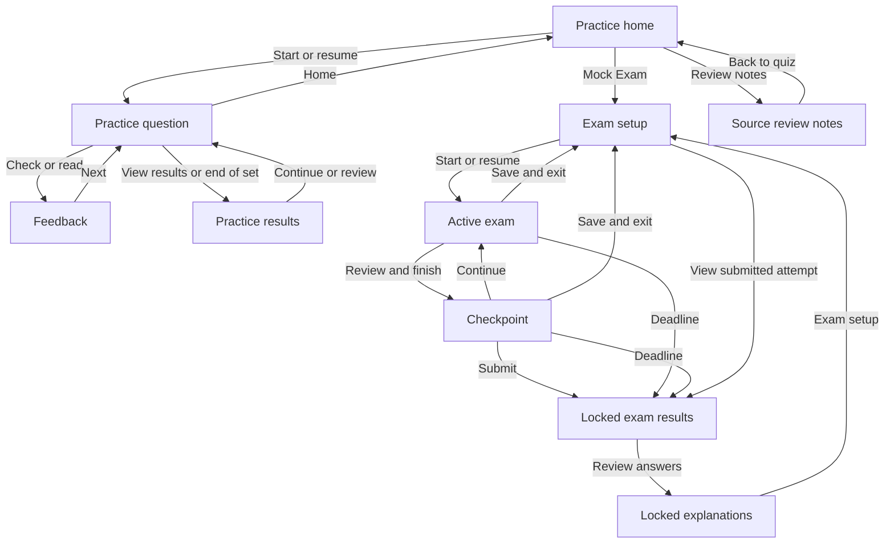

# Quiz requirements and UI/UX design

Status: current product baseline. Last reviewed: 17 October 2026.

This document explains what the quiz must do, the quality constraints it must preserve, and the reasons behind its interface. It is for human maintainers and AI coding assistants. Requirements describe existing behavior and standing design constraints, not proposed features or a claim of complete browser/accessibility certification.

## Reading and maintaining this specification

- **This file:** product requirements, acceptance criteria, and design intent.
- **[README.md](README.md):** implementation ownership, dependency order, and development commands.
- **[architecture.md](architecture.md):** JavaScript objects, design patterns/principles, dependency contracts, and extension rules.
- **[guideline.md](guideline.md):** detailed question import, review, repair, and UI verification rules.
- **[schema.json](schema.json):** exact editable configuration and question formats.
- **Each quiz's `notice.html`:** mock-specific findings, sources, assumptions, repairs, and unresolved items.

Requirement IDs are stable references for changes and reviews. Update requirements, implementation, and checks together when behavior intentionally changes. Keep unimplemented proposals separate. The user's current instructions take precedence over this baseline.

Contents:

1. [Purpose and scope](#1-purpose-and-scope)
2. [Terms and scoring](#2-terms-and-scoring)
3. [Functional requirements](#3-functional-requirements)
4. [Non-functional requirements](#4-non-functional-requirements)
5. [UI/UX design and rationale](#5-uiux-design-and-rationale)
6. [Architecture and data contracts](#6-architecture-and-data-contracts)
7. [Verification and acceptance](#7-verification-and-acceptance)
8. [Known limits](#8-known-limits)

## 1. Purpose and scope

The product is a self-paced certification study tool. Learners choose useful practice, understand answer reasoning, revisit mistakes, and take timed mock exams. Source uncertainty must remain visible and must not become an invented scoring key.

Each quiz is independent: its own entry pages, title, content, and saved progress. Shared code provides consistent behavior and presentation. There is no global quiz picker in the interface.

| User | Need |
| --- | --- |
| New learner | Find a sensible starting point without configuration. |
| Returning learner | Resume unfinished work with selections intact. |
| Learner reviewing mistakes | Distinguish personal mistakes from source-mock repairs. |
| Exam learner | Work against a continuous deadline without early answer feedback. |
| Content reviewer | Trace keys, assumptions, source issues, and supporting references. |
| Human or AI maintainer | Change code/content without breaking progress or design consistency. |

The current product has no accounts, backend, cloud sync, import/export UI, attempt history, theme selector, localization system, runtime AI integration, or in-browser content editor. Authors edit local files. Only the latest exam attempt is retained. This is a study simulation, with no proctoring, official certification result, or guarantee of matching an official exam's distribution.

## 2. Terms and scoring

### Classification and learner states

| Term | Meaning |
| --- | --- |
| Topic / section | A broad subject used for browsing and filtering. |
| Study group | A narrower concept; configured group order can determine teaching order. |
| Must / High / Familiar / Low | Study priorities, not predictions of official exam coverage. |
| Corrected | The source key was demonstrably wrong; grading uses the reviewed key. |
| Repaired | A verified minimal wording/code fix, externally recovered missing content, or expanded accepted single-choice alternatives; the original answer remains accepted. |
| Not scored / ungraded | Unresolved content available for study, excluded from scored accuracy and exam sampling. |
| Draft | An unfinished saved selection, not a practice grade. |
| Correct / Missed | A checked practice result or submitted exam result. |
| Reviewed | An unscored item whose explanation has been opened with the review action. |
| Answered in an active exam | A complete selection of the requested size; correctness remains hidden. |
| Not answered in a submitted exam | No saved selection; earns no points and remains distinct from a wrong selection. |

Corrected, Repaired, and Not scored are mutually exclusive source-review categories. They are independent of learner grades. Explanation-only edits do not by themselves justify a Repaired badge.

Not scored means a reliable grading key has not been established for the supplied question. Use it for essential missing content, no defensible option set, incompatible answer counts, or unresolved wording/version/setup ambiguity that materially changes the answer. A minor typo, an incorrect printed key, or an irrelevant edge case alone does not justify withholding scoring. Preserve the intended task and use supported repairs, key corrections or accepted alternatives when possible.

When opening feedback for a Not scored question, show **Original mock answer (unverified)** with the original key and full corresponding source choice text/code. Keep it neutral and excluded from grading. In saved exam review, retain the original letters and identify their displayed equivalents. If no original key is available, say so. Hide reference answers before feedback, as with scored questions.

Not scored feedback uses the original DOCX mock answer as its answer reference; do not add suggested answer selections. An Online option review disclosure records what was compared and whether missing choices or damaged terms were actually verified. Notices show only a concise unresolved issue; detailed comparison outcomes stay in question feedback.

Not scored multiple-choice questions retain their stated Choose N count independently of the empty grading key. Allow at most N selections, show the selected count, and let users deselect an answer before choosing another. Reading the explanation remains available with no selections. Existing saved selections remain available for review and removal.

Search online papers for matching complete versions of unresolved questions, recording queries, candidate URLs and the outcome in `review.recovery`. Summarize only the current issue or repair in the notice. Restore scoring only after the full task, options and answer are verified. A partial recovery remains Not scored and may show Question changes, with the original key explicitly unverified. Preserve original DOCX snapshots, IDs and option order; distinguish recovered material from invented scenarios.

### Calculation contract

| Measure | Rule |
| --- | --- |
| Practice coverage | Checked scored questions / scored questions in the relevant bank or set. Drafts and unscored reading do not increase it. |
| Practice accuracy | Correct checked scored questions / checked scored questions. Display `—` when none have been checked. |
| Single answer | Exactly one choice matches the canonical key. |
| Multiple answers | The selected set exactly matches the key, regardless of selection order; no partial credit. |
| Equivalent alternatives (`acceptAny`) | Exactly one choice is selected; any listed accepted alternative is correct. This is not multi-select. |
| Unscored progress | Reviewed items / unscored items, separate from scored progress. |
| Exam score | Correct questions / all currently scored questions in the saved sample, including skipped questions. Retired source items do not contribute; an entirely retired attempt has no score. Display percentages rounded to whole numbers. |
| Incomplete exam answer | A nonempty partial/nonmatching selection is incorrect on submission; an empty selection is not answered. |

Practice headings use stable bank/source question IDs and show set position separately. Exam headings, jumps, navigator entries, and result rows use positions `1–N`. Canonical bank/choice IDs remain internal for saving and grading.

## 3. Functional requirements

### Launch and independent navigation

| ID | Requirement and acceptance criteria |
| --- | --- |
| FR-01 | Provide `index.html` for practice, `exam.html` for Mock Exam, and `notice.html` for review notes. Each direct entry opens its appropriate screen. |
| FR-02 | Run from the complete local folder or static HTTP hosting. Local use requires no installation, build, server, upload, or quiz selection. Interactive practice/exams require JavaScript. |
| FR-03 | Identify the current quiz in the header. The identity link and Practice / Mock Exam / Review Notes links stay within its folder. Do not reintroduce the “Your quiz” switcher. |
| FR-04 | Mark the current section visually and with `aria-current="page"`, including its question/result views. |
| FR-05 | At narrow widths, expose section links through Menu with accessible expanded state. Escape closes it and returns focus to the toggle. |
| FR-06 | Footer help opens How to use and Keyboard shortcuts dialogs with close/Escape dismissal. Explain browser-local progress and detected save failures. |
| FR-07 | Validate essential configuration and question relationships at startup. Report errors visibly instead of silently opening another quiz. Loading/no-JavaScript messages explain local-file requirements. |

### Home, browsing, and search

| ID | Requirement and acceptance criteria |
| --- | --- |
| FR-08 | Lead with one useful next action: resume, start the next priority, review missed questions, or revisit completed work. Resume includes the target question number. |
| FR-09 | Resume the saved set/selections. Advance past a completed saved question to the next unfinished item in that set, wrapping when appropriate. |
| FR-10 | Keep Your progress focused on scored coverage, accuracy, and Missed/Unanswered shortcuts. Show unscored reading progress inside Mock review → Not scored, below its description, as “X of Y reviewed”. Disable shortcuts with no eligible items. |
| FR-11 | Offer All questions, By priority, and By topic where configured. Show list counts/progress; disable empty lists. Preserve configured topic and ordered priority/group sequences. |
| FR-12 | Browse-mode changes update the catalog/controls without rebuilding the dashboard, replaying its animation, closing disclosures, or moving the page. Clicking the active mode is a no-op. |
| FR-13 | Search locally by question text, topic/group labels, or exact number (`20`, `Q20`, `#20`). Match keywords case-insensitively and require all entered terms. |
| FR-14 | Search previews show identity, safe excerpt, topic, and progress/draft state, never an answer key or executable imported markup. Announce counts and explain no matches. |
| FR-15 | Preserve the search input/caret during updates. Clear/Escape restores browsing. Enter opens a unique match or focuses the first match. Changing browse mode clears search. |
| FR-16 | Provide Corrected, Repaired, and Not scored practice lists with accurate counts/progress, explanations of the labels, and links to review notes. |
| FR-17 | Put one Reset practice progress button at the bottom of Your progress, without a disclosure or accompanying instructions. Retain confirmation explaining that only this quiz’s practice answers, drafts, and resume point are reset; keep saved exams. Disable the action when no practice state is saved. |
| FR-18 | On completion, offer meaningful review or the next unfinished priority. Do not keep presenting a fresh-start message after scored practice is complete. |

### Practice reader, feedback, and results

| ID | Requirement and acceptance criteria |
| --- | --- |
| FR-19 | Practice is untimed, preserves original choice order, and does not randomly sample questions. All/topic lists use bank ID order; ordered priorities use configured teaching order. |
| FR-20 | Show topic/group, priority, stable question number, applicable source-review badge, scenario/prompt/code, and selection count. Explain missing exhibits and unscored status visibly. |
| FR-21 | A single selection replaces the previous one; multiple selections toggle independently up to the requested maximum. At the maximum, disable unselected options and keep selected options enabled for deselection; re-enable options when below the limit. Apply this to practice, Not scored questions and active exams, including keyboard shortcuts. Show remaining/extra selections without silently truncating older saved over-selections. |
| FR-22 | Enable checking only for exactly the requested selection count. Allow Clear selection before checking. Unscored items allow Read explanation with no selection. |
| FR-23 | Checking saves and reveals chosen versus correct answer/accepted alternatives, reasoning, and distractor explanations. Lock checked choices until Try again. Never invent an answer for an unresolved item. |
| FR-24 | Put study notes, code, technical references, and caveats in Full explanation. For Repaired questions, use one Question changes disclosure, collapsed by default. Lead with Reason for the change, followed by a compact Changed / Unchanged / Answer key summary, distinguishing unchanged letters from changed correct-choice text or expanded accepted alternatives. Show comparisons of the changed question wording/code and each changed choice with Original/Current labels and exact highlights. Keep the removal/addition highlights without a Removed text / Added text legend or a redundant Text changes heading. End with a separate Review notes & sources footer only when needed. Do not repeat the complete original question or nest disclosures. Keep repair reasons out of Full explanation. Preserve original wording, code, and letters in comparisons, with an exam letter key. Stack comparisons at narrow widths. Reveal these only with answer feedback, including submitted exam review. Corrected keys may show concise source-versus-reviewed key feedback. |
| FR-25 | Try again resets only the current practice result/draft and restores editability. Preserve other questions and original choice order. |
| FR-26 | Support Previous, Next, Skip for now, Home, View results, jump, and navigator access as appropriate. Save unfinished selections on navigation. Forward navigation after the final item opens results. |
| FR-27 | Practice jumps accept only a question ID in the current set. Show invalid-input errors without changing questions or losing selections. |
| FR-28 | Navigator entries identify current, correct, missed, draft, reviewed-unscored, and not-started states through accessible labels and visual indicators. |
| FR-29 | Practice Show filters provide All, Answered, Unanswered, and Missed. Checked unscored reviews count as Answered; drafts remain Unanswered. Filtering only changes navigator visibility, never storage/set membership. Explain empty filters and a current question outside the filter. |
| FR-30 | Next unanswered stays in the set, wraps, excludes checked/unscored items and the current question, and disables if no eligible destination exists. The home Unanswered shortcut also excludes unscored items. |
| FR-31 | Results work mid-set and at completion, showing scored metrics and suitable continue/review/home actions. Review-only sets show Reviewed / Not reviewed and no accuracy contribution, never “0 of 0 scored.” |
| FR-32 | Support displayed A–Z choices, Enter to check/continue, and left/right navigation. Preserve native Enter/Space actions, inputs/selects/code/editable regions, help/navigation controls, and modified browser shortcuts. A focused button's Enter must not also trigger a global check. |

### Mock Exam

| ID | Requirement and acceptance criteria |
| --- | --- |
| FR-33 | Keep setup on `exam.html`; practice home only links to it. Use the name Mock Exam consistently. |
| FR-34 | Default count is `min(60, scored pool size)`; accept whole numbers `1–available`. A zero scored pool explains the limitation and offers practice. |
| FR-35 | Default duration is validated `examMinutes`, with a shared 105-minute fallback. Accept whole minutes `1–1440`. Count changes do not scale duration. Invalid input preserves the saved attempt and explains the error. |
| FR-36 | Uniformly sample scored IDs without replacement, shuffle sample order and choices, and create new permutations for a new attempt. Do not mutate source data or imply official topic quotas/pass thresholds. |
| FR-37 | Use exam positions `1–N` consistently. Jump K selects sampled position K, not source ID K. Store/grade canonical IDs. |
| FR-38 | Preserve sample/order, choice permutations, position, selections, and timing across navigation/reload/resume. Repair an invalid permutation without discarding otherwise valid progress. If a source review marks a sampled question Not scored, preserve it and its selections in the saved attempt, explain the adjustment, and exclude it from the current score; new samples still exclude all ungraded items. |
| FR-39 | Before submission show neutral complete/incomplete selection progress, no grades/explanations. Practice grades must not pre-answer/color the exam. Hide the Missed navigator filter while active. |
| FR-40 | Save and next requires a complete selection; skipping/navigation may retain incomplete drafts. Allow clearing and revisiting until submission; auto-save selections. |
| FR-41 | Review & finish is a checkpoint, not submission. Show numbered Answered / Incomplete selection / Not answered states and allow returning, continuing, saving/exiting, or explicit submission. |
| FR-42 | Submission locks the attempt and reveals full-sample score, timing, and read-only per-question explanations, including skipped items. Submitted exam answers have no Try again/edit action. |
| FR-43 | Save & exit returns to setup. Active attempts offer Resume exam; submitted attempts offer View results. Explain that starting a new exam replaces the latest attempt; keep no history. |
| FR-44 | Confirm Clear saved attempt and clear only this quiz's exam, preserving its practice results/drafts/resume. |
| FR-45 | Keep displayed letters consistent across buttons, shortcuts, recaps, highlights, prose references, and distractor explanations. Leave code/URLs literal. Full notes/notices retain source letters; show an original-to-displayed key with exam notes. |

### Exam timing

| ID | Requirement and acceptance criteria |
| --- | --- |
| FR-46 | Start timing immediately; persist duration, start, and absolute deadline. Derive remaining time from deadline/current time, not interval tick counts. |
| FR-47 | Leaving, switching tabs, reloading, saving/exiting, and closing do not pause/reset time. Show the countdown in active questions, checkpoint, and saved-attempt setup. |
| FR-48 | Emphasize/announce five-minute and one-minute warnings without announcing every second. Ticks update timer nodes without replacing the reader or disturbing focus/scroll/drafts. Avoid duplicate intervals; stop after submission/reset. |
| FR-49 | Expiry submits saved selections, locks editing, applies skipped/incomplete grading, and explains automatic submission/time used. Check expiry before edits/submission and on focus/visibility return. |
| FR-50 | Reopening overdue work submits before edits are possible. Record timeout submission at the deadline, not a delayed tick. Setup expiry must not replace practice state. |
| FR-51 | Preserve legacy attempts. First resume of unfinished untimed work grants one configured duration; later resumes keep that deadline. Historical submitted work remains available without invented timing. |

### Saving, isolation, and recovery

| ID | Requirement and acceptance criteria |
| --- | --- |
| FR-52 | Use a unique stable key per quiz, with separate records for results, practice session, and exam. Never reuse/reset a sibling quiz's progress. |
| FR-53 | Save canonical selections automatically and restore compatible drafts/results/resume. Regrade saved practice selections against the current key instead of trusting an old stored grade. |
| FR-54 | Validate stored data: ignore malformed/unknown choices and invalid resume data; reject invalid exam samples, including duplicate/missing IDs. Corruption must not crash the app. |
| FR-55 | Exam actions cannot overwrite practice results/session, including from a stale tab. Reset practice progress resets only practice results, drafts, resume, and practice ordering state; leaving an exam restores independent practice state. |
| FR-56 | A detected save failure keeps the open session usable, shows explicit not-saved guidance, and tells the learner to keep the tab open. Do not label a failed write Saved. |
| FR-57 | Refactors preserve quiz/question/choice IDs, original choice order, storage keys, and save compatibility. Document changed option meanings so old selections can be revisited. |

### Review notes and content integrity

| ID | Requirement and acceptance criteria |
| --- | --- |
| FR-58 | `notice.html` remains readable without JavaScript, including source identity, counts, corrections, repairs, unresolved issues, caveats, references, and a local return link. |
| FR-59 | Provide overview counts, source/scope disclosure, contents, stable anchors, Back to overview links, and enhanced current-section indication. Align counts with data; distinguish repaired-item totals from broader review-note totals. |
| FR-60 | Enhanced search matches exact/grouped question numbers or all words of a phrase. Filter table rows only; keep narrative findings visible. Announce counts, explain empty results, preserve input, clear with Escape/Clear, and focus the first match with Enter. |
| FR-61 | Print every review row despite active search, include source/scope, omit interactive chrome, and restore the prior disclosure state afterward. |
| FR-62 | Follow the shared schema: unique runtime IDs, valid section/focus/group references, at least two choices, valid answer letters/counts, complete metadata, reasoning, distractor explanations, and notes. |
| FR-63 | Preserve original documents and source keys. Source snapshots must reflect the document, not earlier reconstructed content or appended commentary; explicitly document corrections to an inaccurate snapshot. Document missing/repeated source identities and recovery provenance. Never fill a source gap with an unrelated question or describe a supplied assumption as recovered wording. |
| FR-64 | Verify disputed/version-sensitive content with primary documentation. Preserve the original scenario and answer meanings; allow only verified small transcription fixes. Accept supported equivalent single-choice alternatives and leave materially ambiguous, incomplete or unsupported questions unscored. Never supply assumptions or replace option meanings to force a key. Record a dated decision for every question in a full review and publish concise current Corrected, Repaired and Not scored summaries in its notice. Substantial rewrites must be separate study variants outside original-mock scoring/exams. Follow [guideline.md](guideline.md). |
| FR-65 | Support text, prompt, and code blocks; escape imported markup. Inspect source images before declaring them missing. Document replacements/missing context; actual image/diagram support requires a schema/renderer extension. |

## 4. Non-functional requirements

These are quality constraints and evaluation expectations, not a completed formal conformance audit or numerical service guarantee.

| ID | Attribute | Requirement / evaluation |
| --- | --- | --- |
| NFR-01 | Portability | Vanilla HTML/CSS/JS, classic scripts and plain relative paths. No runtime packages, build, backend, ES modules, `fetch`, or XHR for quiz data. Preserve local-file operation. |
| NFR-02 | Independence | Each quiz depends on its own folder and shared `/quiz`, with independent identity/content/storage and no central quiz registry. |
| NFR-03 | Save compatibility | Preserve existing selection meanings and deadlines. Use isolated/in-memory test storage; never erase a learner's real progress for QA. |
| NFR-04 | Reliability | Define safe handling for corrupt data, unavailable saving, empty pools/lists, invalid inputs, interrupted attempts, and late timer events. |
| NFR-05 | Responsiveness | Avoid accidental page-level horizontal overflow. Long titles/code/identifiers/notes/navigators remain usable; intentional code/table overflow stays local. |
| NFR-06 | Alignment | Every page uses `.wrap`; shared width, gutters, and root scrollbar reservation live only in `css/layout.css`. Outer header/body/footer edges align. |
| NFR-07 | Accessibility | Semantic landmarks/headings/labels and native controls; accessible current/pressed/expanded/status states; visible focus; keyboard-only operation; state conveyed beyond color. |
| NFR-08 | Readability and touch | Readable contrast, wrapping, zoom behavior, and task hierarchy. Primary/shared navigation controls are at least 44px high; toolbars wrap instead of shrinking controls. |
| NFR-09 | Interaction stability | Preserve focus/scroll when selecting, caret/input during search, and dashboard/disclosures during browse toggles. Timer ticks do not rerender questions. |
| NFR-10 | Efficiency | Search/filter/grading are local. Prefer targeted updates, frame-scheduled review scroll handling, and one exam interval. No numerical response-time budget is specified. |
| NFR-11 | Motion | Keep animation brief/secondary and respect `prefers-reduced-motion`. Motion is not necessary to understand state. |
| NFR-12 | Privacy/rendering | Store answers locally; no account submission/analytics service. Escape imported content and protect new-tab HTTP(S) references with appropriate `rel`. Optional fonts/external links may use the network. |
| NFR-13 | Maintainability | Shared code/assets/tools stay under `/quiz`; quiz data/findings stay per quiz. Separate core, persistence, controller, and UI responsibilities; document loading/cascade order. |
| NFR-14 | Testability | Shared checks use built-in Node modules and in-memory fixtures. Cover assets/startup, data, grading, drafts/resume, isolation, shuffling, deadlines, notices, and keyboard rules. Node is never required by learners. |
| NFR-15 | Content trust | Describe uncertainty, history, supplied assumptions, and official versus custom weights accurately. Priorities and mock scores do not promise certification outcomes. |
| NFR-16 | Progressive enhancement | Static review findings work without JS. Optional fonts have system fallbacks; interactive pages explain their JavaScript requirement. |
| NFR-17 | Verification honesty | Real-browser review is required for UI changes. Automated checks do not establish visual perfection, full accessibility/cross-browser parity, factual correctness of every item, or live Salesforce behavior. |
| NFR-18 | Object-oriented design | Use instance-owned classes with clear responsibilities, composition, encapsulation, replaceable strategies, and injected external dependencies. Apply repository/command/facade patterns where useful; follow the principles in [architecture.md](architecture.md). Avoid ambient mutable player state and pattern-driven overengineering. |

## 5. UI/UX design and rationale

### Principles

| Principle | Design decision and reason |
| --- | --- |
| Clear next step | A prominent next-action card lets learners start/resume before inspecting every statistic. |
| Independent context | Quiz-specific identity and local links avoid ambiguity about content and progress. |
| Learning versus assessment | Stable, untimed practice reveals reasoning immediately; timed/shuffled exams delay feedback. |
| Honest progress | Coverage, accuracy, unscored review, and exam score answer different questions and use explicit denominators. |
| Separate source quality | Corrected/Repaired/Not scored badges cannot be mistaken for personal grades. |
| Progressive detail | Disclosures keep full notes, source scope, guidance, and reset controls available without dominating the task. |
| Familiar interaction | Native controls and restrained focus/scroll changes keep keyboard, touch, and browser behavior predictable. |
| Consistent frame | Shared spacing, containers, cards, navigation, and footer connect all pages visually. |

### Screen structure and journeys

| Screen | Information hierarchy | Main actions |
| --- | --- | --- |
| Practice home | Header/context; next-step + progress cards; browsing/search + mock-review cards; footer. | Start/resume, choose set, search, review missed/source issues. |
| Practice reader | Header; mode/context toolbar; set progress; question/choices/feedback beside navigator; footer. | Check/read, skip/move/jump, results, Home. |
| Practice results | Shared frame and a narrower readable summary card. | Continue unfinished work, review set/missed items, next priority, Home. |
| Exam setup | Title/introduction; configuration and rules; latest saved attempt; footer. | Start, resume, view results, clear saved attempt. |
| Active exam | Reader frame with shuffled choices, neutral progress, visible countdown. | Save and next, skip/revisit, Review & finish, Save & exit. |
| Submission checkpoint | Numbered completion list, countdown, submission explanation. | Continue/review, submit, save/exit. |
| Submitted exam | Full-sample score, timing, numbered results and locked explanations. | Review answers, return to setup. |
| Review notes | Overview/counts/source scope, contents, search, findings/tables/references. | Jump/search/read, print, return to quiz. |

Questions and results are in-page views of `index.html`; exam setup/questions/checkpoint/results share `exam.html`.



The exam deadline also continues on setup or while the page is closed. Setup expiry submits the saved attempt without forcing the reader open; a closed page catches up on reopening.

### Shared header and footer

The header combines a compact Q mark, small Salesforce practice label, and the current certification title. Titles wrap rather than clip. Desktop section links sit alongside it; at 760px and below a Menu toggle reveals them in a full-width row. Section identity stays consistent throughout its question/result views.

The footer contains How to use, Keyboard shortcuts, and browser-save guidance. Support stays secondary, without duplicating the section links. Native modal help keeps focus within the interaction; answer shortcuts ignore help/header/footer controls. A detected save failure replaces reassuring copy with explicit warning text.

### Home design

Wide layouts use two rows: next-step beside progress, then browsing beside source review. A navy next-step card and mint primary action create hierarchy. Narrow layouts stack cards in reading order. Coverage precedes accuracy. The progress card shows metrics and useful review shortcuts, followed by one Reset practice progress button separated by a subtle divider. Do not add a separate reset section or instructions beside the button. Search and priority/topic toggles belong inside Choose your practice. Study-priority caveats remain accessible without overwhelming the main action.

Unscored reading progress belongs in the Not scored card under Mock review. Put “X of Y reviewed” on its own line below the description, including “0 of Y reviewed” before the first review. Use the reviewed count and that card’s total; do not repeat “Not started”, “complete”, or “reviewed separately” there. Keep this count out of Your progress so scored metrics remain clear. An empty Not scored list remains disabled with the usual no-questions message.

The footer’s How to use dialog is the single home for the practice guide. It groups study order, answer review, source-review labels, mock exams, saved progress, and quiz-specific caveats under short headings. Keep this secondary help outside the question browser and progress metrics. The dialog retains native focus containment and Escape/close behavior, with its title and close control visible while long help scrolls. Keep reset scope in the help dialog and confirmation; do not hide the single reset button under a Manage progress disclosure.

### Reader, feedback, and scrolling

The reader separates scenario, prompt/code, selection guidance, choices, and feedback. Full-width answer buttons pair displayed letters with selection indicators; single and multiple indicators differ in shape. After checking, chosen/correct labels and symbols supplement color. Full explanation holds deeper notes.

At 861px and above, the question shell fits the viewport with flex layout and actual header heights. The reader and 280px navigator consume the remaining space and scroll internally; answer controls remain visible. Do not use guessed header-height subtraction or switch short desktop windows to whole-page question scrolling. Feedback scrolls the reader, not all its ancestors.

At 860px and below, use natural document scrolling and one column. Navigator becomes a disclosure above the reader, initially collapsed on narrow-screen entry. Keep answer controls sticky near the bottom with safe-area spacing. Timed exams keep the local context/timer row sticky at the top; the entire site header need not occupy that sticky region.

The question navigator contains only question navigation: Next unanswered, a labeled question jump and Show filter, the number grid, and its status legend. Group the jump and filter together, use consistent 12px vertical spacing, and retain 44px control targets. Show filter feedback when filtering or following study order; the All option already carries the full count. Keep keyboard help and save guidance in the footer, and Review Notes in the header. On desktop, let the map use the available sidebar height, with a bounded scrolling fallback for browsers without `::details-content` styling.

Use the short visible jump label “Go to” while retaining “Go to question” and exam-range context for screen readers. Align jump and filter controls in rows. Inset the filter chevron 12px from the right edge and reserve enough text padding to avoid overlap. Keep empty-filter feedback next to the controls without a blank map above it, and let jump errors use the full control width.

### Results and assessment design

Summary cards can be narrower for comfortable reading while the outer frame stays aligned. Scored practice uses Correct/Missed/Unanswered/Accuracy; unscored-only sets use Reviewed/Not reviewed. Primary actions follow remaining work.

Exam setup separates explanatory copy from labeled count/time fields on wide screens and stacks on narrow ones. Bounds/errors sit with their fields. Saved-attempt status and matching actions stay together; destructive controls use the shared danger style and neighboring control dimensions. Active exam progress is neutral; the checkpoint states that time continues and submission locks work. Submitted results explicitly include skipped questions in the denominator.

### Review-note design

Desktop has sticky contents beside the article, which starts with a short overview, state counts, and source/scope disclosure. At 800px and below, contents becomes a horizontal locally scrollable strip above the article. At 600px and below, table rows become labeled cards. Preserve table semantics, stable row/section IDs, and question associations. Search hides only matching table content; narrative caveats remain. Printing restores all findings and omits interactive chrome.

### Shared visual system

| Element | Current value / rule |
| --- | --- |
| Outer container | Maximum 1180px; side gutters 24px above 860px, 12px at/below 860px. `.wrap` and scrollbar reservation have one owner: [css/layout.css](css/layout.css). |
| Alignment | Header/body/footer outer edges match across pages. Reserve root scrollbar space to prevent shifts between scrolling pages and the desktop reader. Narrower inner text/result cards are intentional. |
| Type | IBM Plex Sans for body/controls with Segoe UI/sans-serif fallbacks; IBM Plex Serif for major headings with Georgia/serif fallbacks. Fonts are optional. |
| Palette | Navy `#102a43`, text `#15202b`, muted `#5c6b78`, white cards, pale blue/gray surfaces; main home/question/exam surface `#f3f6f8`. Tokens: [css/base.css](css/base.css). |
| Semantics | Green `#0d7a4b` for correct/saved; red `#b42318` for incorrect/destructive states; amber `#8a5a00` for caution. Active section has a soft green surface. Always supplement color with text/symbols. |
| Shape | Soft borders, restrained shadows, generally 18px main-card corners. Shared `nav-control` uses 10px corners, 44px minimum height, consistent type/padding. Answer actions retain their rounded style. |
| Spacing | Preserve existing component spacing and shared gutters. Group controls by task and allow wrapping rather than squeezing them into a fixed row. |
| Code/content | Use `minmax(0, 1fr)` and `min-width: 0` for constrained children. Long code/identifiers must not expand the page. |
| Focus/motion | Visible focus outline/offset, brief feedback/entrance animation, and reduced-motion handling. |
| Cascade | [css/styles.css](css/styles.css) imports base, layout, question, pages, navigation in that order. Review pages additionally load notice styles. |

Different breakpoints serve different components: 860px for gutters/reader scrolling, 780px for home/exam main stacking, 760px for the header menu, 800px for review contents, and 600px for table cards. These do not authorize different page widths. Other small component refinements remain in their stylesheets.

### Feedback and recovery

| Situation | Expected response |
| --- | --- |
| Fresh or completed practice | Appropriate start/review action, no misleading resume/fresh-start claims. |
| Draft | Restore selection and distinguish it from a checked answer. |
| Too few/many selections | Explain how many remain/must be removed; disable check/Save and next. |
| Empty/invalid input | Explain locally, preserve work, and provide recovery through clear, All, or the relevant field. |
| Saving failure | Explicit Not saved guidance; preserve the open session and explain its limit. |
| Checked answer | Distinguish chosen/accepted choices, explain reasoning, keep retry secondary. |
| Timer warning/expiry | Keep urgency visible, then explain automatic locked submission. |
| Reset or replacement | Explain scope; confirm resets and state that a new exam replaces the latest attempt. |
| Help dismissal | Restore ordinary keyboard behavior without answering behind the dialog. |

## 6. Architecture and data contracts

| Layer | Ownership |
| --- | --- |
| Per-quiz files | Configuration, question bank, entry HTML, concise static notices, original documents. No parallel JSON copies or per-quiz runtime loaders. |
| [js/core/model.js](js/core/model.js) | Normalize/validate, grade, and order choices; no DOM/storage access. |
| [js/core/storage.js](js/core/storage.js) | Validate/read/write saved practice, sessions, and exams. |
| [js/core/exam.js](js/core/exam.js) | Attempt lifecycle, practice isolation, absolute deadline, warnings/expiry. |
| [js/ui/content.js](js/ui/content.js) / [js/ui/screens.js](js/ui/screens.js) | Escaped content/explanations and screen markup/display helpers. |
| [js/ui/navigation.js](js/ui/navigation.js) / [js/ui/notice.js](js/ui/notice.js) | Shared chrome/help and optional static-review enhancement. |
| [js/app.js](js/app.js) | `QuizApplication`: instance state, practice actions, rendering/focus/scroll orchestration, composition root/startup facade. |
| [js/ui/events.js](js/ui/events.js) | `QuizDomController`: DOM action commands, keyboard/input events, and listener lifecycle. |

Data scripts assign `window.QUIZ_CONFIG` and `window.QUIZ_QUESTIONS`. Classic scripts register classes in `window.QuizModules`, with private file helpers and instance-owned application state. `app.js` loads last and retains `window.Quiz.start(config, questions)` as the startup facade. Review pages load only navigation then notice enhancement, with `defer`. Follow the exact order in [README.md](README.md#loading) and the object contracts in [architecture.md](architecture.md).

| Storage key | Saved contents |
| --- | --- |
| `<storageKey>` | Practice results by canonical question ID: selected canonical choices and status. Compatible saved selections are regraded on load. |
| `<storageKey>:session` | Practice filter/resume ID, drafts, compatible ordering fields. Legacy shuffled-practice orders must not change current original practice order. |
| `<storageKey>:exam` | Latest sample/order, canonical drafts, choice permutations, position, submitted status, duration/start/deadline/submission timestamps, timeout status. |

Search text, browse mode, navigator Show filter, disclosures, and scroll positions are interaction state, not a promise of persistence across full reloads.

## 7. Verification and acceptance

Run from the repository root for applicable implementation changes:

```sh
node quiz/tools/validate.js
git diff --check
```

| Coverage | Evidence |
| --- | --- |
| Entry points, dependencies, local CSS imports, JS syntax | [tools/validate-assets.js](tools/validate-assets.js), called by the main suite. |
| Independent instances, injected ports/strategies, key compatibility, and lifecycle cleanup | [tools/validate-architecture.js](tools/validate-architecture.js), called by the main suite. |
| Schema/content, practice grading, home/search, drafts/resume, filters, keyboard/focus/scroll contracts | [tools/validate.js](tools/validate.js), using [tools/lib/player.js](tools/lib/player.js). |
| Original practice order, exam mapping, equivalent/multiple answers, code/URLs, legacy selection meaning | [tools/validate-shuffle.js](tools/validate-shuffle.js), called by the main suite. |
| Sampling, numbering, count/time bounds, checkpoint/submission, resets/isolation, deadlines/expiry/migration | [tools/validate-exam.js](tools/validate-exam.js), called by the main suite with a fake clock. |
| Static counts/anchors, grouped/keyword search, empty states, section navigation, printing | [tools/validate-notices.js](tools/validate-notices.js), also runnable separately. |
| Actual layout/accessibility interactions | Real-browser review; automated fixture checks alone do not establish visual correctness. |

After a UI change:

1. Walk home, reader, feedback/full notes, results, exam setup/active/checkpoint/submitted/resume, review notes, and help as affected.
2. Compare page edges with short/long titles at narrow mobile, tablet, desktop, short-window, and enlarged-text/zoom settings. Prior alignment checks used 320, 375, 820, and 1440px widths; old results do not validate a new change.
3. Exercise long code/prose, expanded explanations, large navigators, sticky controls, local overflow, and print layout.
4. Check keyboard-only use, focus, native Enter/Space, answer shortcuts, search actions, menu Escape, and dialogs.
5. Cover fresh, draft, checked, missed, unscored-only, empty, invalid-input, save-failure, and complete states. Use isolated fixtures for writes; preserve real learner progress.
6. Verify exam resume/expiry, hidden pre-submission answers, locked submitted results, and practice/exam isolation.
7. Recheck fixes, run relevant checks, and report actual coverage/remaining limits.

For documentation-only changes, check references and consistency with source/guidelines. Browser-state changes are unnecessary.

## 8. Known limits

- Storage belongs to the browser profile/device and storage context. Host, port, protocol, or local-file location changes can affect access/identity. File-URL behavior is browser-dependent. There is no cloud recovery, export UI, or general cross-tab conflict-merging guarantee.
- Storage may be cleared, blocked, or temporary in private browsing. Save-failure guidance is not a durable backup system.
- Timing depends on the device clock and is not tamper-resistant. A closed page cannot execute submission; it catches up against the original deadline when reopened.
- The bank and keys are client-side files. Delaying feedback is a UI rule, not protection from source inspection.
- CSS/dialog behavior assumes a modern browser, including grid/flex, `:has()`, `dvh`, and `scrollbar-gutter`. Chrome has been used for visual QA; no complete browser/version matrix or formal WCAG conformance audit is established.
- Optional Google Fonts and user-opened external references can require networking. Core quiz data and local interactions do not.
- Automated checks do not establish every question's factual truth, live Salesforce behavior, or future release compatibility. Follow the content review process and preserve evidence in question data and feedback.
- No official pass threshold, topic distribution, difficulty equivalence, performance SLA, or unlimited-bank-size guarantee is specified. Adding one needs an explicit product decision and validation.
